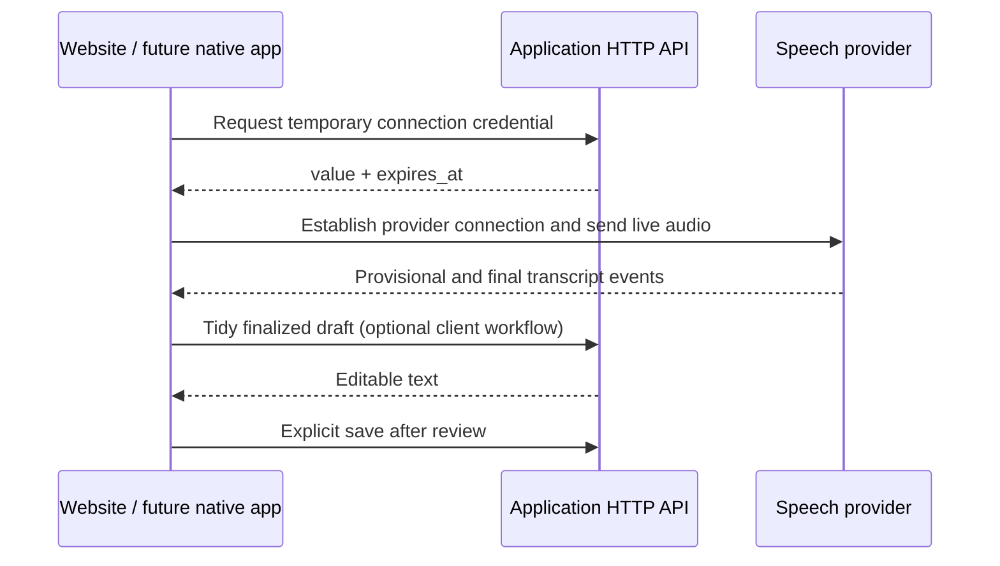

# API client boundaries

The application HTTP API is defined in OpenAPI 3.1 at `/api/openapi.json`. Next.js hosts the Hono application; a native client does not require a separately deployed backend. The current authenticated flows are supported for the same-origin website. This document describes future native integration, not an implemented mobile authentication contract.

## Current HTTP behavior

| Operation                         | Purpose                                              | Current access                                                                                      |
| --------------------------------- | ---------------------------------------------------- | --------------------------------------------------------------------------------------------------- |
| GET `/api/shares`                 | History and implicit anonymous-session establishment | Cookie optional; missing/invalid/expired credentials establish a fresh owner                        |
| POST `/api/shares`                | Explicitly save reviewed text                        | Signed anonymous cookie, or a fresh owner; absent Origin accepted, foreign supplied Origin rejected |
| GET `/api/shares/{id}`            | Read an owned share                                  | Owner-scoped cookie session; another owner's ID is indistinguishable from missing                   |
| GET `/api/public/shares/{id}`     | Read an expiring public reading link                 | Bearer UUID, no owner session required                                                              |
| POST `/api/transcription/session` | Issue a temporary provider connection credential     | Existing cookie and exact Origin required; paid-service flag and burst limit                        |
| POST `/api/shares/cleanup`        | Tidy finalized text without saving                   | Existing cookie and exact Origin required; paid-service flag and separate burst limit               |

OPTIONS advertises methods through Allow. It grants no CORS access. Native HTTP clients are not subject to browser CORS enforcement, but still face every server-side authentication and Origin check. Sending a matching Origin is not proof of identity and is not a native authentication design.

Anonymous ownership currently lives in a signed cookie with a 30-day absolute expiry; there is no login, renewal, account recovery, cross-device ownership transfer or explicit session endpoint. A native cookie jar could technically reproduce some website requests, but losing/expiring that cookie creates a new owner on regular share operations. Do not ship a mobile client assuming automatic recovery or durable history. Storage and paid-operation burst limits are process-local.

## Stable HTTP conventions to reuse

- Consume named OpenAPI models for shares, public shares, `DraftText`, `TranscriptionCredential` and `ApiError`. Generate HTTP client types if useful; no generated Swift/Kotlin client has been validated in this review. The document currently uses relative server URL `/`; a native client must be configured with the intended deployment base URL.
- Failures use `{ "error": { "code": "...", "message": "..." } }`; branch on code and status. Messages are display copy, not stable identifiers. Read the documented allowed codes for each status.
- A 429 on either paid operation includes `Retry-After: 60`, a delay in seconds. This is a process-local burst guard, not a distributed spending guarantee. Do not blindly replay paid operations.
- Credential `expires_at` is a positive integer Unix timestamp in seconds. `value` is a temporary bearer secret: never log, persist, cache or include it in reports. Expiry limits establishing a provider connection; it does not terminate an established recording. Do not copy the browser's ten-minute session policy into a claim about server-enforced quotas.
- Share and cleanup text limits count Unicode code points, not bytes or user-perceived grapheme clusters. Cleanup returns an editable suggestion; it never saves a share.
- Saving remains an explicit action. POST save is not idempotent: a lost response may follow a committed save. Automatic retry can duplicate shares.

The normalized transcription error envelope replaces its previous string-error response. The website handles credential failures by HTTP status; external consumers of the earlier response must migrate. No API versioning policy is introduced here.

## Streaming is a separate boundary

The native-app portion assumes an appropriate future authentication design; current paid endpoints still enforce website Origin/cookie rules. Permanent provider keys stay server-side. Audio goes directly to the selected provider, not through the share-save or cleanup endpoints. Provider processing/retention policies apply independently of Doorknob's lack of audio storage.

OpenAPI describes the HTTP requests, response/error models and credential bootstrap. It does not describe OpenAI's WebRTC SDP exchange or data-channel events. Those belong to the selected provider's protocol and adapter. Generated HTTP clients cannot replace that adapter.

The website's `TranscriptionEngine` contract provides useful native semantics, but its TypeScript/React implementation is not shared native code:

- Start capture only after an explicit user action; report Listening only when the transport is usable.
- Replace provisional text as recognition changes. Append final segments exactly once in audio order.
- Stop capture immediately, allow bounded trailing finalization, then review/edit. Resume appends through a new session.
- Dispose on navigation/interruption and suppress stale callbacks; preserve finalized words through failures.
- Never save provisional text or raw audio. Explicitly save only after review.

Native apps need their own capture, permission, activity indication, background/interruption and provider-transport implementation. Swift/Kotlin or a supported cross-platform SDK can implement these responsibilities; React hooks and browser WebRTC objects remain website-specific. Text cleanup can continue using the same HTTP operation independently of the speech provider.

## Work deliberately left for a mobile milestone

Design explicit session establishment and authentication, secure device credential storage, expiry/recovery and any cross-device identity first. Keep browser CSRF/Origin protections and define native authentication separately; do not simply remove Origin checks or open CORS. Then address durable storage, shared spending limits, save idempotency, contract compatibility checks and a release/versioning policy. This review implements none of those features.
