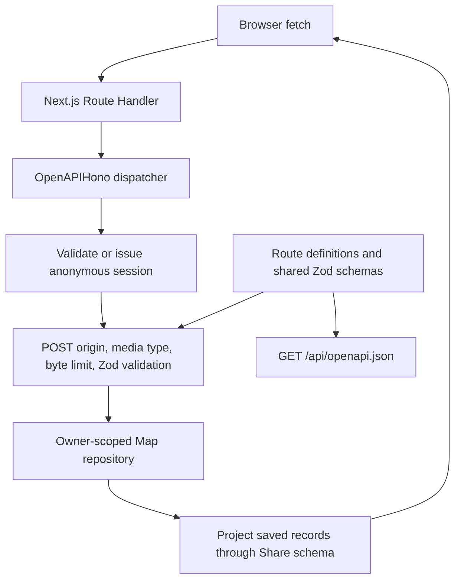

# Architecture

Doorknob v0.2 keeps the React frontend and Next.js Backend for Frontend (BFF) in `jft-app`. App Router Route Handlers run in Node.js. There is no separately deployed backend, database, ORM, login/authentication framework, or external persistence. `@hono/zod-openapi` implements the small HTTP layer within the existing Next.js server; it does not add a separately hosted backend.

## Responsibilities

- `src/app/page.tsx` and `layout.tsx` supply the route entry, metadata, and shared styling. Existing mobile-first components, logo, ivory/navy palette, focus styles, and typography remain in place.
- `src/shares/share-app.tsx` owns screens, the unsaved React draft, requests, heading focus, and loading/error state. Request counters prevent stale history/detail responses from changing newer screens or results. A ref prevents duplicate submits synchronously; a pending state disables editing and the save button. History is fetched on mount to establish a session before saving. Entering Past shares refreshes history unless a list request is already pending.
- `src/shares/components/` presents the reading, form, history, and detail. `src/components/` owns the header/footer. Presentation components do not access persistence.
- `src/shares/api.ts` uses browser `fetch` with same-origin credentials and no caching. It validates responses with shared Zod schemas and coalesces concurrent list reads so initial requests, including React Strict Mode effects, share one cookie issuance. It sends only text on creation and fetches details by ID instead of opening a cached history record.
- `src/shares/model.ts` owns the placeholder reading and shared input/response schemas. Types are inferred from Zod. The strict creation schema rejects client metadata and ownership fields. Response parsing omits server ownership.
- `src/app/api/shares/route.ts` and `[id]/route.ts` are thin dynamic Node dispatch exports for Next.js. `src/app/api/openapi.json/route.ts` exposes the generated specification. Explicit exports let the library handle HEAD, OPTIONS, and rejected App Router methods consistently.
- `src/shares/server/openapi.ts` declares operations with `createRoute`, shared Zod schemas, cookie security, responses, and headers. `app.ts` registers these on `OpenAPIHono`, validates incoming POST JSON through the library, and binds the repository. Responses project through `shareSchema` before serialization. HEAD contracts derive from GET; OPTIONS/405 use the same Allow constants.
- `src/shares/errors.ts` owns stable failure codes/the runtime error envelope. The fetch client preserves codes and status in `ShareApiError`; messages remain display text.
- `src/shares/server/repository.ts` defines a small asynchronous, owner-scoped `ShareRepository` and its Map implementation. Creation validates and trims text, generates metadata, and captures the reading. Every retrieval takes an owner ID, so there is no unscoped private lookup. Returned records are cloned to prevent callers mutating stored snapshots.
- `src/shares/server/session.ts` handles anonymous signed cookies. `http.ts` owns the status/message mapping and protocol/size constants. `app.ts` performs session enforcement and catches expected/unexpected exceptions into private JSON errors without logging sensitive data. The custom DoorknobSession challenge describes cookie credentials, not OAuth or public share tokens. These modules import `server-only` to prevent client bundling.
- `src/shares/dates.ts` preserves saved timestamp/local timezone and reading calendar date/UTC behavior.

## HTTP contract

[The private API reference](API.md) owns request/response examples, validation rules, status codes, cookie-client usage, and retry semantics. The handlers support POST/list at `/api/shares` and owner-checked detail at `/api/shares/:id`. They project stored records through `shareSchema` before returning JSON, removing `ownerId` after authorization. Rejected App Router methods use the coded 405 envelope and Allow. Responses rejected before library dispatch remain framework-owned.

## Request and schema flow

GET/HEAD skip POST input validation. OPTIONS and rejected methods skip session creation. A supplied invalid credential wins over POST input failures. The cookie is attached to successful/non-500 action responses for newly issued sessions; 401 and internal failures do not issue replacements.

Media types use `content-type` parsing rather than handwritten regular expressions. The app normalizes valid application/json before the library validator. It strips the incoming Content-Length from the internal Request so Hono's body-limit middleware counts actual bytes, including streams; it buffers at most 64 KiB. Shared input validation limits raw text to 10,000 Unicode code points before trimming, matching the generated maxLength constraint. Whitespace-only rejection remains a Zod semantic rule described in the contract.

## Anonymous session boundary

On the first API request without a session cookie, the server creates a random UUID owner and signs `<owner UUID>.<expiry epoch seconds>` with HMAC-SHA256. The cookie contains the payload and signature, lasts 30 days, is HttpOnly and SameSite=Lax, and is Secure in production. It is host-only with path `/`. No client ownership parameter is trusted. Signing protects integrity, not confidentiality: the cookie payload includes the owner UUID and expiry. The bearer credential must not appear in JSON, URLs, or logs. A Zod tuple parses the three cookie fields into a typed credential with a UUID owner, numeric expiry, and canonical base64url SHA-256 signature. `getSession` explicitly returns `AnonymousSession`. Schema validation, expiry checking, and timing-safe signature comparison are separate steps; untrusted cookie strings are never asserted into trusted TypeScript types. Malformed, forged, and expired cookies are rejected rather than silently granting a new identity.

Production requires a `SESSION_SECRET` of at least 32 bytes (generate it randomly). Development uses a process-global random secret unless one is configured. Signing configuration is checked when an API request needs the key, not at server startup. Missing production configuration or a nonempty configured value shorter than 32 bytes fails closed with a generic 500. An unset/empty development value selects the random fallback. No fallback production secret is used. POST requires JSON and rejects a supplied foreign Origin; SameSite cookies provide an additional browser boundary. Deploy behind HTTPS, preserving the request origin.

The cookie is a bearer credential. This milestone provides browser-session isolation without login, recovery, cross-device access, revocation, or public sharing tokens. Clearing cookies or expiration loses access to existing shares. The server does not delete those records merely because the cookie is removed. A changed signing secret also invalidates old sessions. Expiration is absolute, not rolling; authenticated requests do not renew it. Tabs/profile windows with the same cookie jar have the same owner. The frontend displays session errors; clearing site cookies starts a fresh session with no prior access.

## Save and read flow

1. Load history and establish a session. Drafts remain in React state.
2. POST only the text. Zod rejects empty/whitespace input and client-supplied metadata. The server associates the validated owner, captures the current placeholder reading, generates UUID/time, and stores a record.
3. Only a confirmed successful response clears the draft and displays the saved share. Failures retain the draft. Pending saves prevent duplicate submissions within the UI.
4. Past shares fetches fresh, newest-first history. Loading, empty, and failed results are distinct; errors offer retry.
5. Opening an entry fetches its current owner-checked detail. Missing and unauthorized IDs both return 404. Detail request failures keep history available.

A network failure after the server commits can leave the client uncertain whether a write succeeded. This milestone has no idempotency key; UI duplicate prevention applies while a request is pending. Refresh history before retrying an ambiguous failed write if avoiding duplicate text matters.

## Persistence boundary and limitations

The Map and development secret are attached to `globalThis` to survive module reloads and separate route bundles within the same Node process. Requests in that process share the data. The repository methods are asynchronous to allow replacing their implementation with a database later; there is no factory or dependency injection framework.

**Restarting the process clears all shares. This is local development storage, not reliable persistence on Vercel or other serverless infrastructure.** Replicas and workers have separate memory; no synchronization, backup, disk writes, or durability exists. The Map grows for the life of the process; cookie expiry does not evict records. There is no deletion endpoint or retention job. A future durable implementation must retain ownership checks and explicit privacy/retention rules.

v0.1 browser persistence, compatibility fixtures, and storage-only tests are removed. There is no migration or import. No v0.3 public links or signed sharing tokens are implemented.

## Verification

[CONTRIBUTING.md](../CONTRIBUTING.md#commands) owns verification commands. `npm run check` includes formatting, lint, Node tests, and the production build/type check. Swagger Parser validates the serialized OpenAPI 3.1 document with external reference loading disabled. Ajv 2020-12 plus ajv-formats validates actual response bodies/required headers against the dereferenced document, including failures and bodyless protocol responses. Boundary tests cover normal/streamed body limits, misleading Content-Length, and Unicode text length. The Node suite enables the `react-server` export condition so server-only modules can be tested without weakening their client boundary. Tests run without child-process isolation so individual tests execute with the TypeScript loader on Node 24. Session tests use test-scoped `context.mock.property(process, 'env', ...)` and automatic restoration instead of assigning to Next.js's readonly `NODE_ENV`. Next.js 16 owns generated route declarations; `tsconfig.json` includes production/development route types and uses the automatic React JSX runtime.

Node tests cover schemas, route handlers, repository snapshots, server-generated metadata, sorting, missing shares, session isolation, invalid credentials, and cross-origin writes. Playwright runs mobile/desktop Chromium against a production build on port 3100 with an isolated synthetic secret. It covers save/reload/detail, heading focus, ordering, draft retention, pending submission behavior, API failures, loading, and empty history. No live feeds or external services are called. Manual layout/keyboard review and server-restart checks remain useful; automated browser coverage does not establish full accessibility conformance.

## Intended mobile direction

React Native with Expo remains an option to evaluate for a future native client. Keep shared schemas independent of React, server storage behind the repository, and web components/navigation specific to this frontend. A native client will need an explicit session credential design; do not assume browser cookies transfer unchanged. Extract a shared package only when another client demonstrates reuse. This milestone adds no native skeleton, audio fields, or harness integration.

## Temporary dependency override

The scoped npm override keeps Next.js's PostCSS at `^8.5.30`, within major 8. It was introduced to address GHSA-6g55-p6wh-862q and GHSA-r28c-9q8g-f849. Next.js 16.4.1 still pins an earlier PostCSS release, so the override is retained and verified by the production build and browser tests. Recheck the override when upgrading Next.js; remove it once the selected release directly depends on a patched version rather than suppressing dependency checks.

## Contributor documentation

[CONTRIBUTING.md](../CONTRIBUTING.md#organization-and-documentation) owns the documentation checklist. Exported repository/session/fetch contracts describe trust boundaries, mutations, return values, and rejected promises or handled HTTP failures at their source. Presentation components document controlled-state/callback responsibilities without duplicating the API contract. [The glossary](DATA_GLOSSARY.md) owns data location, transmission, access loss, deletion, and backup terminology.
