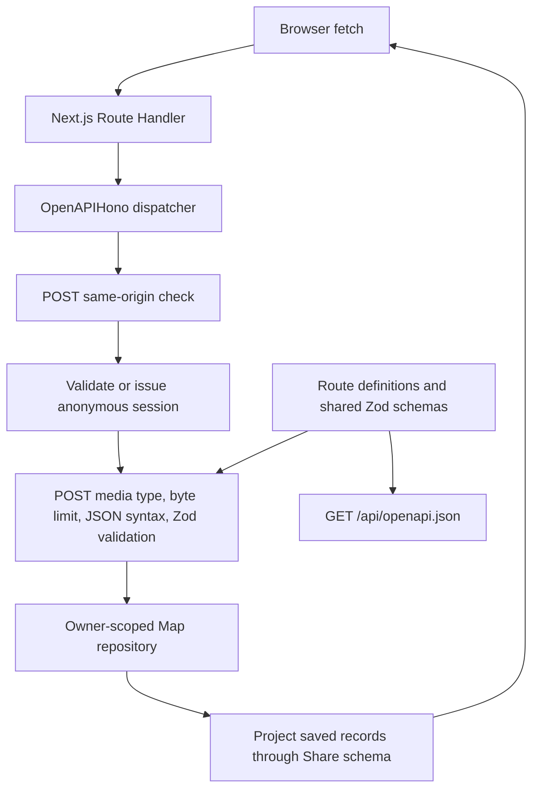

# Architecture

Doorknob v0.3 keeps the React frontend and Next.js Backend for Frontend (BFF) in `jft-app`. App Router Route Handlers run in Node.js. There is no separately deployed backend, database, ORM, login/authentication framework, or external persistence. `@hono/zod-openapi` implements the small HTTP layer within the existing Next.js server; it does not add a separately hosted backend.

## Responsibilities

- `src/app/page.tsx` and `layout.tsx` supply the route entry, metadata, and shared styling. Existing mobile-first components, logo, ivory/navy palette, focus styles, and typography remain in place.
- `src/shares/share-app.tsx` owns screens, the React draft, save/detail requests, and heading focus. Drafts live only in React state. Refresh or leaving the mounted app starts fresh; in-app screen navigation and failed saves retain the current draft. A confirmed save clears it. A mount effect removes the legacy sessionStorage draft key without restoring any text. A ref prevents duplicate submits synchronously. `history/use-share-history.ts` owns the history state type, loading, stale-response protection, and initial session bootstrap. Presentation consumes that state type; the hook does not depend on a component. Detail loading uses a discriminated union so failure always includes a message. Saving stays blocked until bootstrap succeeds; failure preserves the draft and provides retry on the writing screen. Bootstrap retries share one in-flight request, and the submit handler enforces readiness as well as the button. After readiness, history refreshes are independent of saving. It reuses the bootstrap promise across Strict Mode effects, while entering Past shares after initialization always fetches fresh history. Confirmed saves clear the draft without maintaining a second history cache.
- `src/shares/composer/` coordinates the share form, inline transcript, and save action. `composer/recording/` contains focused controls, status, listening clock, icon, and decorative accents. `history/` groups its hook and list presentation; `detail/` groups saved-share display and sharing controls; `reflection/` groups the daily reading and fixture. `src/components/` owns the app-wide header/footer. Presentation components do not access persistence.
- `src/shares/api.ts` uses browser `fetch` with same-origin credentials and no caching. It validates responses with shared Zod schemas and preserves HTTP status even when an error response is not JSON. It sends only text on creation and fetches details by ID instead of opening a cached history record.
- `src/shares/model.ts` owns shared input/response schemas and their inferred types. `reflection/reflection-fixture.ts` supplies the fictional reading to both the UI and server-side share construction. Types are inferred from Zod. The strict creation schema rejects client metadata and ownership fields. Response parsing omits server ownership.
- `src/app/api/shares/route.ts` and `[id]/route.ts` are thin dynamic Node dispatch exports for Next.js. `src/app/api/openapi.json/route.ts` exposes the generated specification. Explicit exports let the library handle HEAD, OPTIONS, and rejected App Router methods consistently.
- `src/shares/server/operations/create-share.ts`, `list-shares.ts`, and `read-share.ts` each encapsulate one operation’s OpenAPI contract and typed handler. Contracts select shared middleware, and handlers call the owner-scoped repository. `resource-methods.ts` owns resource-level HEAD documentation, OPTIONS, and 405 responses. Stateless operations use modules and exported functions rather than controller classes.
- `src/shares/server/openapi.ts` supplies shared contract schemas, headers, HEAD/OPTIONS helpers, and document metadata. `app.ts` directly registers operation contracts/handlers, installs shared validation/error handling and cache policy, and serves the specification. The public operation supplies Hono’s per-route validation hook for generic 404s; shared validation does not inspect path prefixes. Next.js entry files remain adapters with pointers to their operation modules; neither operation modules nor specification generation import Next entry files. `scripts/generate-openapi.ts` serializes the same document to ignored `.tmp/openapi.yaml` for Spectral and CI artifact upload; TypeScript remains authoritative.
- `src/shares/errors.ts` owns stable failure codes/the runtime error envelope. The fetch client preserves codes and status in `ShareApiError`; messages remain display text.
- `src/shares/server/repository.ts` defines the asynchronous, owner-scoped `ShareRepository` interface and `InMemoryShareRepository` class. Each instance encapsulates a private Map; tests can instantiate independent stores. `create-stored-share.ts` owns stored-record validation and construction: trimming text, generating metadata, and capturing the reading before storage. Private retrievals take an owner ID. The trusted `findById` lookup is used only through `public-shares.ts` after capability verification. Returned records are cloned to prevent callers mutating stored snapshots.
- `src/shares/server/session.ts` handles anonymous signed cookies. `http.ts` owns the status/message mapping and protocol/size constants. `middleware.ts` enforces sessions and POST origin/media-type/body limits. `http.ts` owns the typed error-body builder and hides unexpected failures; JSON syntax errors are classified at the body-parsing boundary, while unexpected errors (including arbitrary HTTP exceptions) become generic 500 responses; `app.ts` installs that handler and applies cache policy once at dispatch. These modules import `server-only` to prevent client bundling.
- `src/shares/dates.ts` preserves saved timestamp/local timezone and reading calendar date/UTC behavior.

## HTTP contract

[The private API reference](API.md) owns request/response examples, validation rules, status codes, cookie-client usage, and retry semantics. The handlers support POST/list at `/api/shares` and owner-checked detail at `/api/shares/:id`. They project stored records through `shareSchema` before returning JSON, removing `ownerId` after authorization. Rejected App Router methods use the coded 405 envelope and Allow. Responses rejected before library dispatch remain framework-owned.

## Request and schema flow

GET/HEAD skip POST input validation. OPTIONS and rejected methods skip session creation. POST origin checks precede sessions, so a rejected cross-site form cannot replace an owner cookie. For accepted origins, valid or fresh anonymous ownership is established before body validation. The cookie is attached to successful/non-500 action responses for newly issued sessions; foreign-origin rejections, and internal failures do not issue replacements.

Media types use `content-type` parsing rather than handwritten regular expressions. The app normalizes valid application/json before the library validator. It strips the incoming Content-Length from the internal Request so Hono's body-limit middleware counts actual bytes, including streams; it buffers at most 64 KiB. Shared input validation limits raw text to 10,000 Unicode code points before trimming, matching the generated maxLength constraint. Whitespace-only rejection remains a Zod semantic rule described in the contract.

## Anonymous session boundary

Hono's signed-cookie utilities sign and verify a JSON payload containing a random UUID `ownerId` and numeric `expiresAt`. After signature verification, Zod validates the payload and the server enforces absolute expiry. `getSession` returns a typed `newSession` payload only for new owners; `setSessionCookie` validates and serializes that server-created payload internally before signing. Payload types alone do not establish authenticity. Missing, malformed, forged, or expired cookies start a fresh random owner. Invalid credentials never restore ownership or grant access to old records. This disposable in-memory prototype deliberately has no separate session-recovery workflow. Cookie parsing/signature encoding and cryptographic verification belong to the library, rather than an application-specific credential format. Transport policy and client recovery behavior are documented in [the API reference](API.md#session-and-response-conventions).

This prototype replaces the earlier development cookie format without migration. Old-format cookies automatically start a fresh empty owner; existing test shares are disposable.

Production requires a `SESSION_SECRET` of at least 32 bytes (generate it randomly). Development uses a process-global random secret unless one is configured. Signing configuration is checked when an API request needs the key, not at server startup. Missing production configuration or a nonempty configured value shorter than 32 bytes fails closed with a generic 500. An unset/empty development value selects the random fallback. No fallback production secret is used. POST requires JSON and rejects a supplied foreign Origin; SameSite cookies provide an additional browser boundary. Deploy behind HTTPS, preserving the request origin.

This mechanism provides browser-session isolation without login or account recovery. Public sharing uses a separate key and capability boundary described below. [The API reference](API.md#session-and-response-conventions) owns the cookie/client contract; [the data glossary](DATA_GLOSSARY.md#app-data-lifecycle) owns access loss and retention.

## Save and read flow

1. Load history and establish a session. Drafts remain in React state.
2. POST only the text. Zod rejects empty/whitespace input and client-supplied metadata. The server associates the validated owner, captures the current placeholder reading, generates UUID/time and the share URL, and stores a record.
3. Only a confirmed successful response clears the draft and displays the saved share. Failures retain the draft. Pending saves prevent duplicate submissions within the UI.
4. Past shares fetches fresh, newest-first history. Loading, empty, and failed results are distinct; errors offer retry.
5. Opening an entry fetches its current owner-checked detail. Missing and unauthorized IDs both return 404. Detail request failures keep history available.

A network failure after the server commits can leave the client uncertain whether a write succeeded. This milestone has no idempotency key; UI duplicate prevention applies while a request is pending. Refresh history before retrying an ambiguous failed write if avoiding duplicate text matters.

## Persistence boundary and limitations

One repository instance and the development secret are attached to `globalThis` to survive module reloads and separate route bundles within the same Node process. The repository’s Map stays private; creating another instance creates a separate empty store. Requests in that process share the data. The repository methods are asynchronous to allow replacing their implementation with a database later; there is no factory or dependency injection framework.

**Restarting the process clears all shares. This is local development storage, not reliable persistence on Vercel or other serverless infrastructure.** Replicas and workers have separate memory; no synchronization, backup, disk writes, or durability exists. The Map grows for the life of the process; cookie expiry does not evict records. There is no deletion endpoint or retention job. A future durable implementation must retain ownership checks and explicit privacy/retention rules.

v0.1 browser persistence, compatibility fixtures, and storage-only tests are removed. There is no migration or import. v0.3 adds UUID public links without changing this persistence boundary.

## Public sharing boundary

`createStoredShare` generates a relative `shareUrl` once, before storing the record. The owner receives it in the existing create/list/detail responses; reads never regenerate it. There is no separate link-generation endpoint, request, token table, or recipient tracking. The labeled Share with fellow alcoholic button beneath the written thoughts includes the standard share icon and invokes native sharing immediately with the already available URL, preserving browser user activation. Without native sharing it copies the URL; only clipboard failure reveals an inline selectable field. Cancellation is silent. No sharing panel, expiry label, or delivery claim is shown.

The sharing URL is `/s/{id}`, where `id` is generated by Node's cryptographically secure `randomUUID()` (UUIDv4). The UUID itself is the bearer credential: anyone who learns it can read that record during its lifetime. Every saved share has a link; there is no separate signature, query parameter, sharing secret, or activation state. The fixed lifetime is seven days from saving, without configuration or UI controls. The public service validates the UUID, reads the record, and rejects it at seven days from its server-stored `createdAt`. Client-supplied timestamps cannot extend that limit. There is no reflection text in the URL.

`public-shares.ts` validates UUIDv4 before calling trusted `findById` and returns only `reflection` and `text`. The public API and server-rendered recipient page never require or create session cookies. Malformed UUIDs, expired links, and missing records receive the same API 404; the page shows a generic unavailable message. Unexpected failures are sanitized and thrown to the Next.js error boundary, which shows a retryable error page. Diagnostics never include the raw cause, bearer URL, or reflection content. Private detail/history still require the owning session and omit owner IDs from responses.

Public responses use private/no-store caching, noindex/nofollow and no-referrer headers. The recipient page has static generic metadata and no tracking. Development URL logging is disabled; hosting proxies must redact public sharing paths, including `/s/{id}`, `/api/public/shares/{id}`, and private detail paths containing the same share ID, separately. Anyone holding a link can forward it or retain copies. There is no per-link revocation, regeneration, or deletion endpoint. Links stop working after a week, loss of the underlying record; already received copies cannot be recalled. Restarts erase the in-memory shares. This remains disposable local storage.

On owner and recipient detail pages, `ThoughtsText` renders the complete escaped text with preserved line breaks and wrapping for long words. Only archive entries use a two-line CSS preview. The recipient's **Write your own share** link opens `/` with prefetch disabled, so simply viewing a public share still never bootstraps a session.

## Verification

[CONTRIBUTING.md](../CONTRIBUTING.md#commands) owns commands and test conventions. `npm run check` runs formatting, lint, temporary OpenAPI generation/Spectral lint, Node tests, and the production build/type check. Spectral owns contract conventions; Swagger Parser/Ajv retain structural and response validation. Swagger Parser validates OpenAPI 3.1; Ajv validates response bodies and required headers, including rejecting error codes assigned to another status. Unsupported-method tests assert 405 envelopes and Allow independently of supported operations.

Node tests cover validation, metadata, snapshots, ordering, ownership, signed-session expiry/configuration, byte/Unicode boundaries, and non-JSON HTTP failures. Playwright exercises real Next.js HTTP handling and mobile/desktop save, reload, history, detail, failure, loading, and pending-save flows. Tests use fictional data and no external services. Manual layout/keyboard and process-restart checks complement automated coverage.

## Intended mobile direction

React Native with Expo remains an option to evaluate for a future native client. Keep shared schemas independent of React, server storage behind the repository, and web components/navigation specific to this frontend. A native client will need an explicit session credential design; do not assume browser cookies transfer unchanged. Extract a shared package only when another client demonstrates reuse. This milestone adds no native skeleton, audio fields, or harness integration.

## Temporary dependency override

The scoped npm override keeps Next.js's PostCSS at `^8.5.30`, within major 8. It was introduced to address GHSA-6g55-p6wh-862q and GHSA-r28c-9q8g-f849. Next.js 16.4.1 still pins an earlier PostCSS release, so the override is retained and verified by the production build and browser tests. Recheck the override when upgrading Next.js; remove it once the selected release directly depends on a patched version rather than suppressing dependency checks.

## Contributor documentation

[CONTRIBUTING.md](../CONTRIBUTING.md#organization-and-documentation) owns the documentation checklist. Exported repository/session/fetch contracts describe trust boundaries, mutations, return values, and rejected promises or handled HTTP failures at their source. Presentation components document controlled-state/callback responsibilities without duplicating the API contract. [The glossary](DATA_GLOSSARY.md) owns data location, transmission, access loss, deletion, and backup terminology.

## Speech input

`shares/transcription/types.ts` defines one small session contract: availability, start with listening/interim/final/error/end callbacks, stop with asynchronous finalization, and dispose. A final callback delivers an append-only segment exactly once; interim callbacks replace provisional text. End reports termination whether requested or automatic. Engines sanitize errors to display-safe messages and silence callbacks on disposal. Each engine instance serves one session.

`browser-speech.ts` alone touches SpeechRecognition/webkitSpeechRecognition. It tracks finalized result indices across cumulative result events, requests continuous/interim recognition, selects the browser language, and detaches callbacks before aborting. Stop allows pending final results; a five-second fallback aborts if the browser never sends end. It does not restart automatically. It never uses MediaRecorder or BFF audio transport.

`use-transcription.ts` owns the explicit lifecycle and session generation checks, provisional UI text, and draft appends via `append-transcript.ts`. Disposal/unmount invalidate callbacks. The existing ShareApp draft remains authoritative, without browser-storage recovery. Only final segments reach its state update callback. Each new session begins a paragraph; later segments use spaces. Unicode code point limits retain only content that fits and cancel further recognition. Interim text is discarded on end/error. The form guards submission while recognition is active, then reuses the existing save workflow and text model unchanged.

A future server engine can implement the same contract, internally capturing audio, uploading to the BFF, and emitting final segments after asynchronous transcription. Pass an engine factory to the hook (the browser adapter is the default, and the factory is selected once per mount); the editor and saving code stay unchanged. Such a provider must implement stop/finalization, cancellation and privacy handling, but no provider registry, audio capture, transport, or metadata is introduced now. Browser speech processing can leave the device through the vendor; Doorknob receives only explicitly saved text. No transcript or raw browser error content is logged.

Speech diagnostics are opt-in via `?speechDebug=1` (tab-session persistence; `0` disables). `transcription/diagnostics.ts` emits console-only events with counts, lifecycle, browser capability/context, elapsed timing, and allowlisted error codes. Neither transcript content nor raw browser errors are passed to the logger. The adapter observes optional audio/sound/speech events without changing recognition behavior; the hook logs draft commits and lifecycle/context changes. Logs are not sent to the BFF. README documents enablement and interpretation.

The recording UI consumes an optional engine `activity` callback, a speech-detection hint rather than audio amplitude. The browser adapter maps speech-start/end and audio-end events into that hint; the hook also pulses activity briefly on recognition results for browsers that omit speech boundary events. Activity state and its timer are cleared on termination/unmount and protected by the session generation. `LiveTranscript` renders the existing draft plus provisional text, automatically following within its own scroll container while respecting user scrollback. It creates no additional transcript model. The form owns a listening-time display and microphone/accents; the teleprompter contains the single inline text field, while explicit saving remains unchanged.

Recorder maintenance: browser terminal paths share one idempotent resource-release helper. The hook selects its engine factory once per mount so renders cannot interrupt recording. It uses session invalidation to reject further callbacks after stop completion, error, unmount, or the text limit; it does not maintain a second acceptance flag. Button/status labels are computed before rendering and the decorative speech bars share one component. Diagnostic enablement is resolved once per recording-experience mount, so speech events do not repeatedly parse the URL or touch storage.

`LiveTranscript` uses `react-textarea-autosize` for text measurement, viewport resizing, and font-load updates. Application code still owns transcript following and respects user scrollback. Browser tests cover resizing existing text in both directions and preserving scrollback. Provider-independent hook tests use React Testing Library and jsdom with an injected asynchronous fake engine, covering stop/finalization, stale callbacks, cleanup, and limits. They run in a separate client React process from the server-only tests; no microphone, provider credentials, or network are involved.

Lifecycle hardening: only a `starting` session can transition to `listening`; callbacks received while stopping cannot resume the microphone UI, while pending final text is still accepted. The browser adapter treats `no-speech` as a normal end and maps microphone capture failures through the app-authored descriptions in `browser-speech-errors.ts`. Speech activity hold time, stop finalization grace time, and the transcript following threshold are named constants beside their owning code. Root-level Strict Mode hook tests exercise setup–cleanup–setup, probe disposal, pending activity timer cancellation, and stale callbacks after unmount. Test paths mirror the transcription feature, with client React tests explicitly separated from server-bound Node tests.
