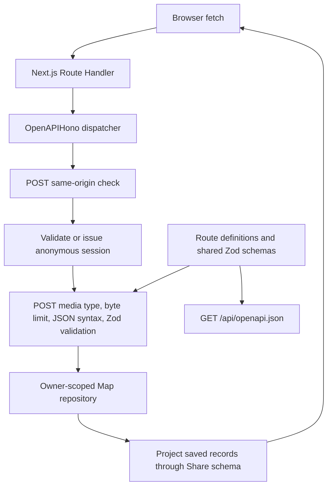
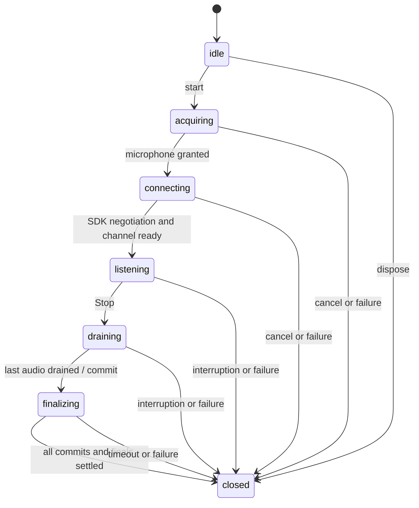

# Architecture

Doorknob v0.3 keeps the React frontend and Next.js Backend for Frontend (BFF) in `jft-app`. App Router Route Handlers run in Node.js. There is no separately deployed backend, database, ORM, login/authentication framework, or external persistence. `@hono/zod-openapi` implements the small HTTP layer within the existing Next.js server; it does not add a separately hosted backend.

## Responsibilities

- `src/app/page.tsx` and `layout.tsx` supply the route entry, metadata, and shared styling. Existing mobile-first components, logo, ivory/navy palette, focus styles, and typography remain in place.
- `src/shares/use-share-application.ts` owns screens, the React draft, cleanup, save/detail requests and async transition guards. `share-app.tsx` composes presentation and handles heading focus/scroll. Drafts live only in React state. Refresh or leaving the mounted app starts fresh; in-app screen navigation and failed saves retain the current draft. A confirmed save clears it. The retired draft-key migration has been removed; the application neither reads nor writes that legacy key. Old values are ignored rather than maintained indefinitely. A ref prevents duplicate submits synchronously. `history/use-share-history.ts` owns the history state type, loading, stale-response protection, and initial session bootstrap. Presentation consumes that state type; the hook does not depend on a component. Detail loading uses a discriminated union so failure always includes a message. Saving stays blocked until bootstrap succeeds; failure preserves the draft and provides retry on the writing screen. Bootstrap retries share one in-flight request, and the submit handler enforces readiness as well as the button. After readiness, history refreshes are independent of saving. It reuses the bootstrap promise across Strict Mode effects, while entering Past shares after initialization always fetches fresh history. Confirmed saves clear the draft without maintaining a second history cache.
- `src/shares/composer/` coordinates the share form, inline transcript, and save action. `composer/recording/` contains focused controls, status, listening clock, icon, and decorative accents. `history/` groups its hook and list presentation; `detail/` groups saved-share display and sharing controls; `reflection/` groups the daily reading and fixture. `src/components/` owns the app-wide header/footer. Presentation components do not access persistence.
- `src/shares/api.ts` uses browser `fetch` with same-origin credentials and no caching. It validates responses with shared Zod schemas and preserves HTTP status even when an error response is not JSON. It sends only text on creation and fetches details by ID instead of opening a cached history record.
- `src/shares/model.ts` owns shared input/response schemas and their inferred types. `reflection/reflection-fixture.ts` supplies the fictional reading to both the UI and server-side share construction. Types are inferred from Zod. The strict creation schema rejects client metadata and ownership fields. Response parsing omits server ownership.
- `src/app/api/shares/route.ts` and `[id]/route.ts` are thin dynamic Node dispatch exports for Next.js. `src/app/api/openapi.json/route.ts` exposes the generated specification. Explicit exports let the library handle HEAD, OPTIONS, and rejected App Router methods consistently.
- `src/shares/server/http/operations/create-share.ts`, `list-shares.ts`, and `read-share.ts` each encapsulate one operation’s OpenAPI contract and typed handler. Contracts select shared middleware, and handlers call the owner-scoped repository. `resource-methods.ts` owns resource-level HEAD documentation, OPTIONS, and 405 responses. Stateless operations use modules and exported functions rather than controller classes.
- `src/shares/server/http/openapi.ts` supplies shared contract schemas, headers, HEAD/OPTIONS helpers, and document metadata. `app.ts` directly registers operation contracts/handlers, installs shared validation/error handling and cache policy, and serves the specification. The public operation supplies Hono’s per-route validation hook for generic 404s; shared validation does not inspect path prefixes. Next.js entry files remain adapters with pointers to their operation modules; neither operation modules nor specification generation import Next entry files. `scripts/generate-openapi.ts` serializes the same document to ignored `.tmp/openapi.yaml` for Spectral and CI artifact upload; TypeScript remains authoritative.
- `src/shares/errors.ts` owns stable failure codes/the runtime error envelope. The fetch client preserves codes and status in `ApiRequestError`; messages remain display text.
- `src/shares/server/storage/repository.ts` defines the asynchronous, owner-scoped `ShareRepository` interface and `InMemoryShareRepository` class. Each instance encapsulates a private Map; tests can instantiate independent stores. `storage/create-stored-share.ts` owns stored-record validation and construction: trimming text, generating metadata, and capturing the reading before storage. Private retrievals take an owner ID. The trusted `findById` lookup is used only through `application/read-public-share.ts` after capability verification. Returned records are cloned to prevent callers mutating stored snapshots.
- `src/shares/server/auth/session.ts` handles anonymous signed cookies. `http/errors.ts` owns the status/message mapping and protocol/size constants. `http/middleware.ts` enforces sessions and POST origin/media-type/body limits. `http/errors.ts` owns the typed error-body builder and hides unexpected failures; JSON syntax errors are classified at the body-parsing boundary, while unexpected errors (including arbitrary HTTP exceptions) become generic 500 responses; `app.ts` installs that handler and applies cache policy once at dispatch. These modules import `server-only` to prevent client bundling.
- `src/shares/dates.ts` preserves saved timestamp/local timezone and reading calendar date/UTC behavior.

## HTTP contract

[The private API reference](API.md) owns request/response examples, validation rules, status codes, cookie-client usage, and retry semantics. The handlers support POST/list at `/api/shares` and owner-checked detail at `/api/shares/:id`. They project stored records through `shareSchema` before returning JSON, removing `ownerId` after authorization. Rejected App Router methods use the coded 405 envelope and Allow. Responses rejected before library dispatch remain framework-owned.

## Request and schema flow

GET/HEAD skip POST input validation. OPTIONS and rejected methods skip session creation. POST origin checks precede sessions, so a rejected cross-site form cannot replace an owner cookie. For accepted origins, valid or fresh anonymous ownership is established before body validation. The cookie is attached to successful/non-500 action responses for newly issued sessions; foreign-origin rejections, and internal failures do not issue replacements.

Media types use `content-type` parsing rather than handwritten regular expressions. The app normalizes valid application/json before the library validator. It strips the incoming Content-Length from the internal Request so Hono's body-limit middleware counts actual bytes, including streams; it buffers at most 64 KiB. Shared input validation limits raw text to 10,000 Unicode code points before trimming, matching the generated maxLength constraint. Whitespace-only rejection remains a Zod semantic rule described in the contract.

## Anonymous session boundary

Hono's signed-cookie utilities sign and verify a JSON payload containing a random UUID `ownerId` and numeric `expiresAt`. After signature verification, Zod validates the payload and the server enforces absolute expiry. `getSession` returns a typed `newSession` payload only for new owners; `setSessionCookie` validates and serializes that server-created payload internally before signing. Payload types alone do not establish authenticity. Missing, malformed, forged, or expired cookies start a fresh random owner. Invalid credentials never restore ownership or grant access to old records. This disposable in-memory prototype deliberately has no separate session-recovery workflow. Cookie parsing/signature encoding and cryptographic verification belong to the library, rather than an application-specific credential format. Transport policy and client recovery behavior are documented in [the API reference](API.md#session-and-response-conventions).

This prototype replaces the earlier development cookie format without migration. Old-format cookies automatically start a fresh empty owner; existing test shares are disposable.

Production requires a `SESSION_SECRET` of at least 32 bytes (generate it randomly). Development uses a process-global random secret unless one is configured. Signing configuration is checked when an API request needs the key, not at server startup. Missing production configuration or a nonempty configured value shorter than 32 bytes fails closed with a generic 500. An unset/empty development value selects the random fallback. No fallback production secret is used. POST requires JSON and rejects a supplied foreign Origin; SameSite cookies provide an additional browser boundary. Deploy behind HTTPS, preserving the request origin.

This mechanism provides browser-session isolation without login or account recovery. Public sharing uses a separate key and capability boundary described below. [The API reference](API.md#session-and-response-conventions) owns the cookie/client contract; [the data glossary](DATA_GLOSSARY.md#app-data-lifecycle) owns access loss and retention.

## Save and read flow

1. Load history and establish a session. Drafts remain in React state.
2. POST only the text. Zod rejects empty/whitespace input and client-supplied metadata. The server associates the validated owner, captures the current placeholder reading, generates UUID/time and the share URL, and stores a record.
3. Only a confirmed successful response clears the draft and displays the saved share. Failures retain the draft. Pending saves prevent duplicate submissions within the UI.
4. Past shares fetches fresh, newest-first history. Loading, empty, and failed results are distinct; errors offer retry.
5. Opening an entry fetches its current owner-checked detail. Missing and unauthorized IDs both return 404. Detail request failures keep history available.

A network failure after the server commits can leave the client uncertain whether a write succeeded. This milestone has no idempotency key; UI duplicate prevention applies while a request is pending. Refresh history before retrying an ambiguous failed write if avoiding duplicate text matters.

## Persistence boundary and limitations

One repository instance and the development secret are attached to `globalThis` to survive module reloads and separate route bundles within the same Node process. The repository’s Map stays private; creating another instance creates a separate empty store. Requests in that process share the data. The repository methods are asynchronous to allow replacing their implementation with a database later; there is no factory or dependency injection framework.

**Restarting the process clears all shares. This is local development storage, not reliable persistence on Vercel or other serverless infrastructure.** Replicas and workers have separate memory; no synchronization, backup, disk writes, or durability exists. The Map grows for the life of the process; cookie expiry does not evict records. There is no deletion endpoint or retention job. A future durable implementation must retain ownership checks and explicit privacy/retention rules.

v0.1 browser persistence, compatibility fixtures, and storage-only tests are removed. There is no migration or import. v0.3 adds UUID public links without changing this persistence boundary.

## Public sharing boundary

`createStoredShare` generates a relative `shareUrl` once, before storing the record. The owner receives it in the existing create/list/detail responses; reads never regenerate it. There is no separate link-generation endpoint, request, token table, or recipient tracking. The labeled Share with fellow alcoholic button beneath the written thoughts includes the standard share icon and invokes native sharing immediately with the already available URL, preserving browser user activation. Without native sharing it copies the URL; only clipboard failure reveals an inline selectable field. Cancellation is silent. No sharing panel, expiry label, or delivery claim is shown.

The sharing URL is `/s/{id}`, where `id` is generated by Node's cryptographically secure `randomUUID()` (UUIDv4). The UUID itself is the bearer credential: anyone who learns it can read that record during its lifetime. Every saved share has a link; there is no separate signature, query parameter, sharing secret, or activation state. The fixed lifetime is seven days from saving, without configuration or UI controls. The public service validates the UUID, reads the record, and rejects it at seven days from its server-stored `createdAt`. Client-supplied timestamps cannot extend that limit. There is no reflection text in the URL.

`application/read-public-share.ts` validates UUIDv4 before calling trusted `findById` and returns only `reflection` and `text`. The public API and server-rendered recipient page never require or create session cookies. Malformed UUIDs, expired links, and missing records receive the same API 404; the page shows a generic unavailable message. Unexpected failures are sanitized and thrown to the Next.js error boundary, which shows a retryable error page. Diagnostics never include the raw cause, bearer URL, or reflection content. Private detail/history still require the owning session and omit owner IDs from responses.

Public responses use private/no-store caching, noindex/nofollow and no-referrer headers. The recipient page has static generic metadata and no tracking. Development URL logging is disabled; hosting proxies must redact public sharing paths, including `/s/{id}`, `/api/public/shares/{id}`, and private detail paths containing the same share ID, separately. Anyone holding a link can forward it or retain copies. There is no per-link revocation, regeneration, or deletion endpoint. Links stop working after a week, loss of the underlying record; already received copies cannot be recalled. Restarts erase the in-memory shares. This remains disposable local storage.

On owner and recipient detail pages, `ThoughtsText` renders the complete escaped text with preserved line breaks and wrapping for long words. Only archive entries use a two-line CSS preview. The recipient's **Write your own share** link opens `/` with prefetch disabled, so simply viewing a public share still never bootstraps a session.

## Verification

[CONTRIBUTING.md](../CONTRIBUTING.md#commands) owns commands and test conventions. `npm run check` runs formatting, lint, temporary OpenAPI generation/Spectral lint, Node tests, and the production build/type check. Spectral owns contract conventions; Swagger Parser/Ajv retain structural and response validation. Swagger Parser validates OpenAPI 3.1; Ajv validates response bodies and required headers, including rejecting error codes assigned to another status. Unsupported-method tests assert 405 envelopes and Allow independently of supported operations.

Node tests cover validation, metadata, snapshots, ordering, ownership, signed-session expiry/configuration, byte/Unicode boundaries, and non-JSON HTTP failures. Playwright exercises real Next.js HTTP handling and mobile/desktop save, reload, history, detail, failure, loading, and pending-save flows. Tests use fictional data and no external services. Manual layout/keyboard and process-restart checks complement automated coverage.

## Intended mobile direction

React Native with Expo remains an option to evaluate for a future native client. Keep shared schemas independent of React, server storage behind the repository, and web components/navigation specific to this frontend. A native client will need an explicit session credential design; do not assume browser cookies transfer unchanged. Extract a shared package only when another client demonstrates reuse. This milestone adds no native skeleton, audio fields, or harness integration.

## Temporary dependency override

The scoped npm override keeps Next.js's PostCSS at `^8.5.30`, within major 8. It was introduced to address GHSA-6g55-p6wh-862q and GHSA-r28c-9q8g-f849. Next.js 16.4.1 still pins an earlier PostCSS release, so the override is retained and verified by the production build and browser tests. Recheck the override when upgrading Next.js; remove it once the selected release directly depends on a patched version rather than suppressing dependency checks.

## Contributor documentation

[CONTRIBUTING.md](../CONTRIBUTING.md#organization-and-documentation) owns the documentation checklist. Exported repository/session/fetch contracts describe trust boundaries, mutations, return values, and rejected promises or handled HTTP failures at their source. Presentation components document controlled-state/callback responsibilities without duplicating the API contract. [The glossary](DATA_GLOSSARY.md) owns data location, transmission, access loss, deletion, and backup terminology.

## Speech input

`shares/transcription/types.ts` remains the provider-independent session contract: start with listening/activity/interim/final/error/end callbacks, asynchronous stop/finalization, and canceling disposal. Each final segment appends exactly once; interim text replaces provisional words. The editor never imports provider SDKs, captures audio, or reconciles multiple transcription sources. Replace the default factory import in `use-transcription.ts` to replace the provider; no registry or plugin layer is needed.

`transcription/providers/openai/engine.ts` owns one explicitly started browser WebRTC session and resource lifetime. It requests microphone access, obtains an ephemeral credential from the same-origin BFF, exchanges SDP directly with OpenAI, sends microphone tracks, and reads JSON transcript events from the data channel. `OpenAITranscriptionSession` uses the official SDK’s `OpenAIRealtimeWebRTC` helper for native negotiation, channel parsing/subscriptions and connection closure. The app owns microphone capture and tracks, authenticated SDP HTTP exchange, turn commits and finalization. The official OpenAI SDK is used server-side for credential issuance. There is no audio playback, MediaRecorder, audio file upload, persistent socket through Amplify, or browser SpeechRecognition fallback.

`microphone-activity.ts` analyzes the live microphone locally without connecting it to speakers or retaining samples beyond the analysis buffer. Sound activity drives the existing accents, and approximately 800 ms of silence commits an audio turn. `gpt-live-transcribe` streams provisional deltas before commit and does not support server VAD, so client silence detection supplies the commit boundary. It is amplitude detection, not guaranteed speech classification; noise and quiet speech can affect timing. A commit at stop also finalizes uninterrupted speech.

`transcription/providers/openai/results.ts` holds only bounded, transient protocol state keyed by audio item ID. It deduplicates completed items, uses committed previous-item links to emit finals in audio order, combines incremental deltas as provisional text, and replaces those words with the authoritative punctuated completion. Out-of-order completions wait for their predecessors. `providers/openai/protocol.ts` bounds and deduplicates decoded events and tracks outstanding commits; duplicate item acknowledgements cannot settle another commit. Unknown protocol events are ignored; malformed known frames and provider failures terminate with app-authored messages. Neither frames nor raw errors are logged.

Stop releases microphone tracks and the audio context immediately, allows a short RTP drain before the final data-channel commit, and then waits at most five seconds for pending finals. Timeout reports possible incomplete finalization. Startup has a 20-second timeout; sessions automatically stop at ten minutes. Errors, terminal connection failures, track loss, hidden pages, page exit, text limits, navigation/unmount, and disposal close resources and silence stale callbacks. Late microphone permission grants release their tracks. No automatic reconnect/restart occurs. RTP and data channels are independently delivered; the brief drain is best-effort, and real-device testing must validate trailing-word behavior.

`use-transcription.ts` selects its factory once per mount and owns UI state, session invalidation, provisional words, activity hold time, and appends through `append-transcript.ts`. The parent draft remains authoritative. Final words preserve concurrent inline edits; each new session starts a paragraph. Unicode limits cancel capture and retain accepted text. Only explicit saving writes a share; successful explicit Stop also sends the finalized draft for the cleanup operation described below. The prompter follows incoming words inside its own scroll container and respects deliberate scrollback. Refresh starts a fresh draft.

`server/http/operations/transcription-session.ts` registers the documented POST credential operation. It requires an exact same-origin Origin header, an existing valid signed session, and `STT_ENABLED=true`; it never creates a new anonymous session. Responses are private/no-store, return only ephemeral credential fields, and hide all provider/configuration failures. The server fixes the initial model and transcription-only configuration. A bounded process-local guard permits five issuance attempts per owner per minute; it is not a distributed quota or authorization system. Modified clients can reuse credentials or override session settings. Protected preview access and provider project controls remain necessary.

`server/providers/openai/key.ts` reads a server-only environment binding locally or a plain-string AWS Secrets Manager value at runtime using the Amplify branch's SSR compute IAM role. Successful secret reads are cached in process for five minutes; failures are not cached. The permanent key never enters client code or credential responses. No credentials are needed to build or run deterministic tests. [Deployment instructions](TRANSCRIPTION.md) own branch configuration and access/cost limitations.

OpenAI processes microphone audio remotely. Doorknob persists no audio; provider retention is separate from app storage. [README](../README.md#processing-retention-and-cost) and [the glossary](DATA_GLOSSARY.md#speech-data) describe processing, retention, and costs. `diagnostics.ts` remains opt-in, console-only, and limited to lifecycle/count/category metadata. Deterministic engine tests cover protocol corrections/order/deduplication, finalization, errors, deadlines and resource release. Provider-independent hook tests cover repeated sessions, edits/limits, stale callbacks and Strict Mode. Playwright mocks only browser/provider boundaries and exercises the real app; live provider and physical phone validation are separate.

## Draft cleanup

`cleanup/use-share-cleanup.ts` is owned by the mounted ShareApp, holding the current cleaned draft across in-app navigation. `useTranscription` invokes its completion callback only after explicit Stop successfully finalizes at least one new nonblank segment, including trailing results. Error/cancel/limit/automatic end paths do not trigger cleanup. The provider engine contract is unchanged. `composer/use-share-composer.ts` coordinates recording, automatic cleanup, retry and submit guards; `ShareForm` renders that state and delegates user actions. The form holds recording/saving during cleanup and lets typing cancel it. Navigation/unmount abort pending requests; request identity plus current-source checks suppress stale results even when cancellation is ignored. No draft enters browser storage. A successful save clears it. A reduced-motion-aware loading wheel and Tidying! status appear above the transcript during cleanup.

`cleanup/api.ts` sends one bounded, cancellable finalized-text request. `server/http/operations/clean-share.ts` documents POST `/api/shares/cleanup`, validates exact origin and an existing signed session before parsing a 64 KiB-limited JSON body, checks the shared 10,000-code-point schema, and applies a separate bounded process-local five-attempts/minute guard. It creates no session and never calls the repository. Static cleanup method handling precedes dynamic share-ID handling.

`server/providers/openai/cleanup.ts` uses the official OpenAI Responses SDK with `gpt-5.4-mini`, reasoning disabled, `store:false`, no tools, a timeout and no retries. A structured response is validated against the same bounded nonblank text schema. Incomplete, refused, empty or oversized responses are rejected rather than truncating or replacing the original. Instructions favor frequent mobile-friendly paragraphs (usually one or two sentences, roughly 20–45 words) and light filler editing, preservation of meaning and voice, and treating embedded commands as transcript data. These instructions are not a guarantee of semantic preservation; explicit review/save remains necessary. Safe diagnostics omit all text and raw errors.

`ThoughtsText` renders each blank-line-separated paragraph as its own escaped paragraph element with larger spacing on small screens, retaining single line breaks inside paragraphs. Saved share schema, storage and public sharing boundaries stay the same. Cleanup sends an unsaved finalized draft through the BFF to OpenAI before saving; provider retention is separate from the app's lack of persistence. See README for privacy and cost. Tests cover access/size limits, non-stored structured requests, refusals/incomplete output, Unicode, stale requests, cancellation, automatic Stop behavior, and browser save/history/sharing of paragraph text. Live model editing quality remains a separate check.

## Startup latency and progress

Record waits for the existing private-session bootstrap so its credential request has a signed cookie. After a recording tap, native microphone acquisition begins synchronously and the temporary-credential request starts alongside the permission wait. No microphone or provider request is started on page load. Once the microphone is granted, the engine emits an optional `connecting` event: the hook changes from waiting for permission to Connecting transcription, while keeping saving disabled and cancellation available. SDP/local ICE preparation overlaps the credential wait; the authenticated OpenAI SDP exchange still requires both. Listening is reported only after the actual data channel opens. A first-time permission decision and remote connection establishment remain real prerequisites; this change does not pretend to listen early or buffer raw audio.

Pending credential rejections are handled while waiting for permission. Stop/navigation/unmount abort requests, silence callbacks and release any late microphone grant. Optional `speechDebug` diagnostics record rounded `elapsedMs` for permission, credential acquisition, SDP preparation, remote SDP exchange and total time to channel open, without credential/audio data. These overlapping stages may log in a different order from the former sequential startup.

## Provider boundaries

`transcription/provider.ts` selects a `TranscriptionEngineFactory`; the hook and composer import no OpenAI modules. The existing engine contract normalizes replacement interim text, exactly-once final segments, activity, startup progress and terminal events. `server/transcription-provider.ts` selects the matching server credential issuer and safe diagnostics. Browser and server OpenAI implementations live in their respective `providers/openai/` directories; shared microphone capture/activity and hook draft handling remain outside them.

`server/cleanup-provider.ts` selects text cleanup independently. Both current OpenAI operations share `providers/openai/client.ts` for server-only key resolution and SDK settings, with separate deadlines. `auth/burst-limit.ts` removes duplicated limiter code while retaining independent transcription and cleanup allowances. See [the code review and provider replacement guide](TRANSCRIPTION_REVIEW.md).

## Recording ownership and lifecycle

`OpenAITranscriptionSession` implements `TranscriptionEngine`; one instance owns one explicit recording. Its single phase replaces overlapping readiness/stopping/disposal flags:

Every phase permits terminal disposal; it invalidates callbacks before aborting setup and closing resources. Native peer `failed`/`closed`, channel failures and malformed messages terminate the session. The SDK permits a transient peer `disconnected` state to recover; Stop, page hiding, navigation, the session limit and terminal failures still release capture. A late microphone grant is immediately stopped. The SDK never owns supplied media tracks. Local RMS activity remains app-owned and stops with capture. Protocol state owns ordering/acknowledgements without depending on browser resources, React or storage. The SDK parses JSON before the app checks the decoded event size and bounded transcript/ID collections; the size check is not a pre-parse network-frame limit.

Server organization follows responsibilities: `http/operations/` owns contracts and handlers; `http/` owns HTTP validation/errors/specification; `auth/` owns session cookies and process-local access limits; `storage/` owns records and the repository; `application/` owns public-reading policy; `providers/` owns external services. `app.ts` and the provider selection files compose these parts. Browser and server OpenAI `config.ts` modules contain immutable non-secret policy; server prompt text lives in `cleanup-prompt.ts`, and `key.ts` alone resolves credentials. No shared client/server config import can pull secret lookup into browser bundles.

## API client boundaries

HTTP access checks are composed independently: optional/exact Origin middleware enforces browser request policy; existing-session middleware supplies verified ownership without cookie creation. Both paid operations compose exact Origin and existing-session checks before provider work. Origin is never an identity credential. Their responses use the shared coded error envelope and named OpenAPI models, with required retry headers and explicit Unix-second expiry units. The current cookie and same-origin behavior remains website-oriented; [API client boundaries](API_CLIENTS.md) describes what a native client can reuse and what needs separate authentication design. OpenAPI covers application HTTP operations; it does not define the provider's live audio/event protocol.

## Screen and client ownership

`detail/saved-share-screen.tsx` owns the owner detail content, navigation, footer and persistent sharing actions. A ResizeObserver measures the action bar, including manual-link/status controls, safe-area padding and text wrapping, and reserves matching space within the same screen. `ShareDetail` renders the reading and expandable owner text; the parent no longer guesses a bottom padding. Recipient pages continue to render full thoughts directly.

The composer receives explicit session readiness/saving flags and a narrow cleanup status/action contract. A synchronous pending check supplements rendered status to prevent same-event request races. Application requests and draft ownership stay mounted across screen changes; transcription remains scoped to the mounted composer. Shared `http-client.ts` owns fetch credentials/cache defaults and HTTP error parsing; endpoint modules own request methods, payloads, schemas and AbortSignals. Cleanup discards failure bodies and retains its fixed safe message. The helper never retries or owns application transitions.

## Configurable speech deployment

The Node instrumentation entry validates `STT_PROVIDER`, and `server/transcription-config.ts` fixes it for the process lifetime. The runtime home page serializes only this nonsecret choice through `TranscriptionBootstrap`; the hook retains the chosen factory for its mount. Session requests assert the same provider, preventing stale deployments from receiving a different transport's credentials. OpenAI's SDK/WebRTC engine and independent cleanup provider retain their existing responsibilities.

The xAI adapter owns a gesture-resumed AudioContext, microphone tracks, PCM AudioWorklet, relay socket and finalization timers. The BFF signs short-lived relay tickets after existing origin/cookie/rate checks. `services/xai-relay/` runs separately from Amplify, authenticates tickets, and forwards bounded frames to a fixed xAI endpoint with its own API key. It is a single-process service with local replay protection, no audio/text persistence and no payload logs. See [deployment, protocol and operational constraints](TRANSCRIPTION.md#provider-selection-and-xai-relay). No save/share/history responsibilities move into the relay.
