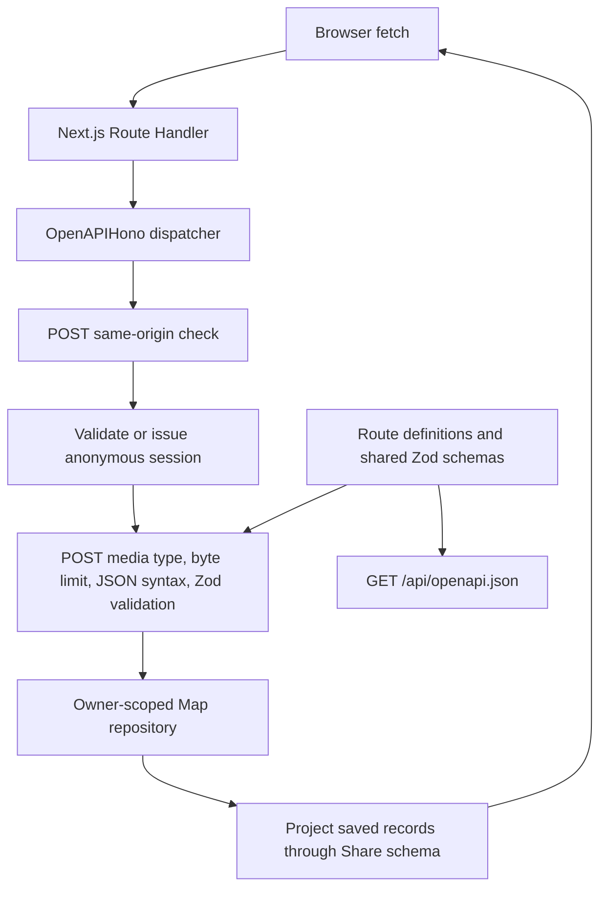

# Architecture

Doorknob v0.3 keeps the React frontend and Next.js Backend for Frontend (BFF) in `jft-app`. App Router Route Handlers run in Node.js. There is no separately deployed backend, database, ORM, login/authentication framework, or external persistence. `@hono/zod-openapi` implements the small HTTP layer within the existing Next.js server; it does not add a separately hosted backend.

## Responsibilities

- `src/app/page.tsx` and `layout.tsx` supply the route entry, metadata, and shared styling. Existing mobile-first components, logo, ivory/navy palette, focus styles, and typography remain in place.
- `src/shares/share-app.tsx` owns screens, the React draft, save/detail requests, and heading focus. A ref prevents duplicate submits synchronously. `use-share-history.ts` owns the history state type, loading, stale-response protection, and initial session bootstrap. Presentation consumes that state type; the hook does not depend on a component. Detail loading uses a discriminated union so failure always includes a message. Saving stays blocked until bootstrap succeeds; failure preserves the draft and provides retry on the writing screen. Bootstrap retries share one in-flight request, and the submit handler enforces readiness as well as the button. After readiness, history refreshes are independent of saving. It reuses the bootstrap promise across Strict Mode effects, while entering Past shares after initialization always fetches fresh history. Confirmed saves clear the draft without maintaining a second history cache.
- `src/shares/components/` presents the reading, form, history, and detail. `src/components/` owns the header/footer. Presentation components do not access persistence.
- `src/shares/api.ts` uses browser `fetch` with same-origin credentials and no caching. It validates responses with shared Zod schemas and preserves HTTP status even when an error response is not JSON. It sends only text on creation and fetches details by ID instead of opening a cached history record.
- `src/shares/model.ts` owns shared input/response schemas and their inferred types. `reflection-fixture.ts` supplies the fictional reading to both the UI and server-side share construction. Types are inferred from Zod. The strict creation schema rejects client metadata and ownership fields. Response parsing omits server ownership.
- `src/app/api/shares/route.ts` and `[id]/route.ts` are thin dynamic Node dispatch exports for Next.js. `src/app/api/openapi.json/route.ts` exposes the generated specification. Explicit exports let the library handle HEAD, OPTIONS, and rejected App Router methods consistently.
- `src/shares/server/operations/create-share.ts`, `list-shares.ts`, and `read-share.ts` each encapsulate one operation’s OpenAPI contract and typed handler. Contracts select shared middleware, and handlers call the owner-scoped repository. `resource-methods.ts` owns resource-level HEAD documentation, OPTIONS, and 405 responses. Stateless operations use modules and exported functions rather than controller classes.
- `src/shares/server/openapi.ts` supplies shared contract schemas, headers, HEAD/OPTIONS helpers, and document metadata. `app.ts` directly registers operation contracts/handlers, installs shared validation/error handling and cache policy, and serves the specification. Next.js entry files remain adapters with pointers to their operation modules; neither operation modules nor specification generation import Next entry files. `scripts/generate-openapi.ts` serializes the same document to ignored `.tmp/openapi.yaml` for Spectral and CI artifact upload; TypeScript remains authoritative.
- `src/shares/errors.ts` owns stable failure codes/the runtime error envelope. The fetch client preserves codes and status in `ShareApiError`; messages remain display text.
- `src/shares/server/repository.ts` defines the asynchronous, owner-scoped `ShareRepository` interface and `InMemoryShareRepository` class. Each instance encapsulates a private Map; tests can instantiate independent stores. `create-stored-share.ts` owns stored-record validation and construction: trimming text, generating metadata, and capturing the reading before storage. Private retrievals take an owner ID. The trusted `findById` lookup is used only through `public-shares.ts` after capability verification. Returned records are cloned to prevent callers mutating stored snapshots.
- `src/shares/server/session.ts` handles anonymous signed cookies. `http.ts` owns the status/message mapping and protocol/size constants. `middleware.ts` enforces sessions and POST origin/media-type/body limits. `http.ts` owns the typed error-body builder and translates explicit session failures; JSON syntax errors are classified at the body-parsing boundary, while unexpected errors (including arbitrary HTTP exceptions) become generic 500 responses; `app.ts` installs that handler and applies cache policy once at dispatch. The custom DoorknobSession challenge describes cookie credentials, not OAuth or public share tokens. These modules import `server-only` to prevent client bundling.
- `src/shares/dates.ts` preserves saved timestamp/local timezone and reading calendar date/UTC behavior.

## HTTP contract

[The private API reference](API.md) owns request/response examples, validation rules, status codes, cookie-client usage, and retry semantics. The handlers support POST/list at `/api/shares` and owner-checked detail at `/api/shares/:id`. They project stored records through `shareSchema` before returning JSON, removing `ownerId` after authorization. Rejected App Router methods use the coded 405 envelope and Allow. Responses rejected before library dispatch remain framework-owned.

## Request and schema flow

GET/HEAD skip POST input validation. OPTIONS and rejected methods skip session creation. POST origin checks precede sessions, so a rejected cross-site form cannot replace an owner cookie. For accepted origins, invalid credentials win over body validation failures. The cookie is attached to successful/non-500 action responses for newly issued sessions; foreign-origin rejections, 401, and internal failures do not issue replacements.

Media types use `content-type` parsing rather than handwritten regular expressions. The app normalizes valid application/json before the library validator. It strips the incoming Content-Length from the internal Request so Hono's body-limit middleware counts actual bytes, including streams; it buffers at most 64 KiB. Shared input validation limits raw text to 10,000 Unicode code points before trimming, matching the generated maxLength constraint. Whitespace-only rejection remains a Zod semantic rule described in the contract.

## Anonymous session boundary

Hono's signed-cookie utilities sign and verify a JSON payload containing a random UUID `ownerId` and numeric `expiresAt`. After signature verification, Zod validates the payload and the server enforces absolute expiry. `getSession` returns a typed `newSession` payload only for new owners; `setSessionCookie` validates and serializes that server-created payload internally before signing. Payload types alone do not establish authenticity. Missing cookies bootstrap a new owner; supplied malformed, forged, or expired credentials are rejected. Cookie parsing/signature encoding and cryptographic verification belong to the library, rather than an application-specific credential format. Transport policy and client recovery behavior are documented in [the API reference](API.md#session-and-response-conventions).

This prototype replaces the earlier development cookie format without migration. Clear the old site cookie once if it receives 401; existing test shares are disposable.

Production requires a `SESSION_SECRET` of at least 32 bytes (generate it randomly). Development uses a process-global random secret unless one is configured. Signing configuration is checked when an API request needs the key, not at server startup. Missing production configuration or a nonempty configured value shorter than 32 bytes fails closed with a generic 500. An unset/empty development value selects the random fallback. No fallback production secret is used. POST requires JSON and rejects a supplied foreign Origin; SameSite cookies provide an additional browser boundary. Deploy behind HTTPS, preserving the request origin.

This mechanism provides browser-session isolation without login or account recovery. Public sharing uses a separate key and capability boundary described below. [The API reference](API.md#session-and-response-conventions) owns the cookie/client contract; [the data glossary](DATA_GLOSSARY.md#app-data-lifecycle) owns access loss and retention.

## Save and read flow

1. Load history and establish a session. Drafts remain in React state.
2. POST only the text. Zod rejects empty/whitespace input and client-supplied metadata. The server associates the validated owner, captures the current placeholder reading, generates UUID/time, and stores a record.
3. Only a confirmed successful response clears the draft and displays the saved share. Failures retain the draft. Pending saves prevent duplicate submissions within the UI.
4. Past shares fetches fresh, newest-first history. Loading, empty, and failed results are distinct; errors offer retry.
5. Opening an entry fetches its current owner-checked detail. Missing and unauthorized IDs both return 404. Detail request failures keep history available.

A network failure after the server commits can leave the client uncertain whether a write succeeded. This milestone has no idempotency key; UI duplicate prevention applies while a request is pending. Refresh history before retrying an ambiguous failed write if avoiding duplicate text matters.

## Persistence boundary and limitations

One repository instance and the development secret are attached to `globalThis` to survive module reloads and separate route bundles within the same Node process. The repository’s Map stays private; creating another instance creates a separate empty store. Requests in that process share the data. The repository methods are asynchronous to allow replacing their implementation with a database later; there is no factory or dependency injection framework.

**Restarting the process clears all shares. This is local development storage, not reliable persistence on Vercel or other serverless infrastructure.** Replicas and workers have separate memory; no synchronization, backup, disk writes, or durability exists. The Map grows for the life of the process; cookie expiry does not evict records. There is no deletion endpoint or retention job. A future durable implementation must retain ownership checks and explicit privacy/retention rules.

v0.1 browser persistence, compatibility fixtures, and storage-only tests are removed. There is no migration or import. v0.3 adds stateless signed public links without changing this persistence boundary.

## Signed sharing boundary

The owner explicitly calls `POST /api/shares/:id/link`. `sameOrigin` runs before `existingSession`, which requires a valid existing anonymous session and never bootstraps one. An owner-scoped lookup returns generic 404 for missing or foreign records, then `share-links.ts` signs `share:v1\n{id}\n{expires}` with HMAC-SHA256. There are no token records, link counters, recipient identities, or mutations to saved shares. Responses contain a relative bearer URL and Unix expiry. The browser resolves the relative URL against its own origin rather than trusting an inbound Host header for an absolute URL.

`SHARE_LINK_SECRET` is a separate random key, required in production (at least 32 bytes, different from the session key), or generated once in process-global development memory. Both secrets remain server-only. `SHARE_LINK_TTL_SECONDS` defaults to seven days and accepts 1–31,536,000 seconds; invalid configuration fails closed. Verification uses a UUID, a canonical positive safe-integer timestamp, and a canonical 32-byte unpadded base64url MAC. It compares equal-length MACs with Node `timingSafeEqual`. Purpose/version, exact ID, and expiry are authenticated; reflection text never enters the URL. The clock is injectable for deterministic tests.

`public-shares.ts` combines verification and the trusted repository lookup, in that order, and projects records through `publicShareSchema` to return only `reflection` and `text`. Neither the public API (`GET /api/public/shares/:id`) nor the server-rendered recipient page (`/s/:shareId`) imports session middleware. Missing, malformed, duplicate, tampered, expired, and nonexistent capabilities have the same API 404. Unexpected server/configuration failures remain generic 500; the recipient page fails closed with the same unavailable display. The recipient page has generic static metadata, no tracking, and no private app controller or history navigation. It reads storage through the service directly rather than fetching its own API, keeping the token out of server fetch logs.

API responses use `private, no-store`. Public responses and pages also use `X-Robots-Tag: noindex, nofollow` and `Referrer-Policy: no-referrer`, including unavailable responses. The dynamic Next page uses the framework's private/no-store cache directives. Metadata also requests noindex/nofollow and no-referrer. `next.config.ts` disables development logging to keep capability URLs out of framework request logs; deployment proxies must redact query strings independently. No application code logs secrets, links, cookies, or shared text.

`ShareLinkControls` is mounted on saved/detail screens. It generates only on an explicit click, prevents duplicate pending requests, displays expiry/access/forwarding limitations, and retains the link only in React memory. Clipboard failures select a read-only field for manual copying. Native sharing is invoked directly from a separate click (preserving user activation) after link creation; unsupported APIs, permission errors, and cancellation have distinct safe feedback. It never claims recipient delivery. Navigating away discards that screen's link state; previously issued links remain valid.

A capability grants read access to anyone holding it until expiry or loss of the underlying record. It does not grant private history access or authority to mint new links. There is no immediate revocation or share-deletion endpoint in v0.3. Future deletion will invalidate all links through absence of the record. Restarting loses shares and any ephemeral keys. Copies already received cannot be recalled, and configured-key rotation invalidates all links at once. Durability, per-link tracking, and recipient authentication remain out of scope.

## Verification

[CONTRIBUTING.md](../CONTRIBUTING.md#commands) owns commands and test conventions. `npm run check` runs formatting, lint, temporary OpenAPI generation/Spectral lint, Node tests, and the production build/type check. Spectral owns contract conventions; Swagger Parser/Ajv retain structural and response validation. Swagger Parser validates OpenAPI 3.1; Ajv validates response bodies and required headers, including rejecting error codes assigned to another status. Unsupported-method tests assert 405 envelopes and Allow independently of supported operations.

Node tests cover validation, metadata, snapshots, ordering, ownership, signed-session expiry/configuration, byte/Unicode boundaries, and non-JSON HTTP failures. Playwright exercises real Next.js HTTP handling and mobile/desktop save, reload, history, detail, failure, loading, and pending-save flows. Tests use fictional data and no external services. Manual layout/keyboard and process-restart checks complement automated coverage.

## Intended mobile direction

React Native with Expo remains an option to evaluate for a future native client. Keep shared schemas independent of React, server storage behind the repository, and web components/navigation specific to this frontend. A native client will need an explicit session credential design; do not assume browser cookies transfer unchanged. Extract a shared package only when another client demonstrates reuse. This milestone adds no native skeleton, audio fields, or harness integration.

## Temporary dependency override

The scoped npm override keeps Next.js's PostCSS at `^8.5.30`, within major 8. It was introduced to address GHSA-6g55-p6wh-862q and GHSA-r28c-9q8g-f849. Next.js 16.4.1 still pins an earlier PostCSS release, so the override is retained and verified by the production build and browser tests. Recheck the override when upgrading Next.js; remove it once the selected release directly depends on a patched version rather than suppressing dependency checks.

## Contributor documentation

[CONTRIBUTING.md](../CONTRIBUTING.md#organization-and-documentation) owns the documentation checklist. Exported repository/session/fetch contracts describe trust boundaries, mutations, return values, and rejected promises or handled HTTP failures at their source. Presentation components document controlled-state/callback responsibilities without duplicating the API contract. [The glossary](DATA_GLOSSARY.md) owns data location, transmission, access loss, deletion, and backup terminology.
